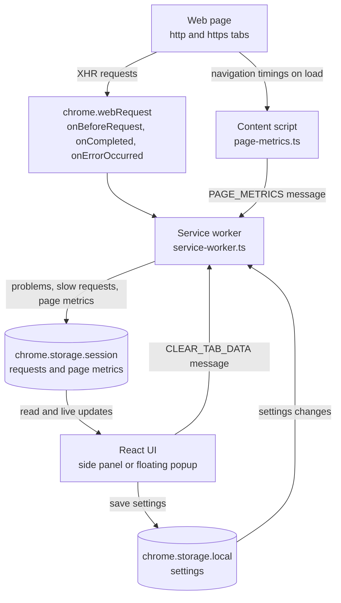

<p align="center">
  
</p>

<h1 align="center">API Pulse</h1>

<p align="center">
  A Chrome extension that spots failing API calls, network errors, and slow requests while you browse, with page-load timings alongside.
</p>

<p align="center">
  
  
  
  
  
  
</p>

## Table of contents

- [Overview](#overview)
- [Features](#features)
- [Tech stack](#tech-stack)
- [Architecture](#architecture)
- [Data model](#data-model)
- [Project structure](#project-structure)
- [Getting started](#getting-started)
- [Using API Pulse](#using-api-pulse)
- [Settings and defaults](#settings-and-defaults)
- [Permissions and data handling](#permissions-and-data-handling)
- [Limitations](#limitations)
- [Releasing](#releasing)

## Overview

API Pulse helps developers spot API failures, network errors, and slow requests while browsing a website. It also records key page-navigation timings, so you can investigate common API and page-performance issues without leaving the browser. Monitoring runs in the background, so history builds up even when the panel is closed.

A request is recorded when it returns an HTTP `4xx` or `5xx` status that isn't ignored, when it fails without an HTTP response (unless network errors are turned off), or when it takes at least the slow-request threshold.

The interface opens in Chrome's side panel or as a floating popup. **Page performance** shows load time, DOM content loaded, Time to First Byte (TTFB), and the number of captured requests for the current tab. **API problems** lists grouped issues with filters, export, copy, and clear actions.

Captured data stays in your browser. The current code does not send it to a remote server (see [Permissions and data handling](#permissions-and-data-handling)).

## Features

- **HTTP error monitoring:** captures `4xx` and `5xx` responses for XMLHttpRequest (XHR) traffic.
- **Configurable ignored status codes:** `401 Unauthorized` is ignored by default. Change the list in settings.
- **Network error detection:** records requests that fail without an HTTP response, such as connection failures. Intentionally aborted requests (`net::ERR_ABORTED`) are excluded.
- **Slow-request detection:** flags requests that meet or exceed your duration threshold.
- **Page performance metrics:** shows page load time, `DOMContentLoaded`, and TTFB for the current tab.
- **Filters:** switch between All, 4xx, 5xx, Network, and Slow.
- **Duplicate grouping:** merges repeated issues that share a kind, method, URL, status, and error, and shows occurrence and slow counts. Query strings and fragments are stripped, so requests to the same path group together.
- **Request details:** copies a grouped request's method, URL, status, error, duration, counts, and last-observed time to the clipboard.
- **Export reports:** exports the current tab's filtered view as JSON or CSV, including page timings when they are available.
- **Per-tab cleanup:** clears captured requests and page metrics for the current tab only.
- **Display options:** use Chrome's side panel or a floating popup, with a dark or light theme.
- **Bounded history:** keeps up to 250 request entries and 50 tab page-metric entries, pruned by your retention period.

## Tech stack

| Layer | Technology |
|-------|------------|
| UI | React 19 with TypeScript |
| Build and dev server | Vite 8 with CRXJS (`@crxjs/vite-plugin`) |
| Extension platform | Chrome Extensions Manifest V3 |
| Request monitoring | Service worker using `chrome.webRequest` |
| Page timings | Content script using the Navigation Timing API |
| Styling | Tailwind CSS 4 |
| Icons | Lucide React |
| Storage | `chrome.storage.session` for history, `chrome.storage.local` for settings |
| Type checking | TypeScript 6 project references (`tsc -b`) |
| Linting | ESLint 10 |
| Testing | Vitest |
| Package manager | pnpm |
| Releases | GitHub Actions |

## Architecture



API Pulse has four cooperating parts:

- **Service worker** (`src/background/service-worker.ts`) listens to `chrome.webRequest` events for XHR traffic, decides which requests are worth keeping, and stores them with their durations. It also saves page metrics sent by the content script, applies retention limits, clears a tab's data on request, and reacts to settings changes.
- **Content script** (`src/content/page-metrics.ts`) runs on `http` and `https` pages. After the page loads, it reads the navigation timing entry and sends load, DOM content loaded, and TTFB values to the service worker once per page load.
- **React UI** (`src/App.tsx`, `src/components/`, `src/hooks/`) runs in the side panel or popup. It reads history and settings, groups and filters requests, and handles settings changes, export, copy, and clear actions.
- **Shared library** (`src/lib/`) defines the settings schema and defaults, monitoring types and limits, HTTP status classification, and helpers for grouping, formatting, and exporting data.

## Data model

| Record | Storage location | Main fields |
|--------|------------------|-------------|
| `CapturedRequest` | `chrome.storage.session`, key `apiPulseMonitoring` | `id`, `tabId`, `method`, `url`, `kind` (`http` or `network`), `status`, `error`, `durationMs`, `isSlow`, `timestamp` |
| `PageMetrics` | `chrome.storage.session`, key `apiPulseMonitoring` | `tabId`, `url`, `loadMs`, `domContentLoadedMs`, `ttfbMs`, `capturedAt` |
| `AnalyzerSettings` | `chrome.storage.local`, key `apiAnalyzerSettings` | `ignoredStatusCodes`, `includeNetworkErrors`, `retentionHours`, `slowRequestThresholdMs`, `theme`, `displayMode` |

URLs are stored as origin and path only, so query strings and fragments never reach storage. Records older than the retention period are removed whenever monitoring data updates. Settings are validated on read, and invalid values fall back to their defaults.

## Project structure

```text
api-pulse/
├── .github/
│   └── workflows/
│       └── release.yml                   # Builds and publishes releases on v* tags
├── public/
│   └── logo.svg                          # README logo
├── src/
│   ├── background/
│   │   └── service-worker.ts             # Watches XHR traffic and stores monitoring data
│   ├── components/
│   │   ├── ApiProblemsSection.tsx        # Filters, export, clear, and grouped request list
│   │   ├── AppHeader.tsx                 # Title, view mode, theme, and settings toggles
│   │   ├── EmptyState.tsx                # Placeholder for empty states
│   │   ├── MetricCard.tsx                # Single labeled metric tile
│   │   ├── PerformanceSection.tsx        # Page timing cards for the current tab
│   │   ├── RequestCard.tsx               # One grouped request with badges and a copy button
│   │   └── SettingsPanel.tsx             # Monitoring settings form
│   ├── content/
│   │   └── page-metrics.ts               # Reports navigation timings to the service worker
│   ├── hooks/
│   │   ├── useActiveTab.ts               # Tracks the active website tab
│   │   ├── useAnalyzerSettings.ts        # Loads and syncs settings
│   │   └── useMonitoringData.ts          # Loads and syncs monitoring history
│   ├── lib/
│   │   ├── utils/
│   │   │   └── request.ts                # Grouping, formatting, CSV, and download helpers
│   │   ├── analyzer-settings.ts          # Settings schema, defaults, and normalization
│   │   ├── classify-status.ts            # Decides which HTTP status codes are reported
│   │   ├── classify-status.test.ts       # Vitest tests for status classification
│   │   └── monitoring-types.ts           # Shared types, storage key, and history limits
│   ├── App.tsx                           # Main layout, filters, export, and settings actions
│   ├── index.css                         # Tailwind entry stylesheet
│   └── main.tsx                          # React entry point
├── dist/                                 # Build output; load this folder in Chrome
├── index.html                            # Entry page for the side panel and popup
├── manifest.config.ts                    # Manifest V3 definition
├── vite.config.ts                        # Vite and CRXJS configuration
├── package.json
├── pnpm-lock.yaml
├── tsconfig.json
├── tsconfig.app.json
├── tsconfig.node.json
└── README.md
```

## Getting started

### Install a release

1. Open the [Releases](../../releases) page and download `api-pulse-extension.zip` from the latest release.
2. Extract the ZIP. The extracted `dist` folder contains `manifest.json`.
3. Open `chrome://extensions` in Chrome and turn on **Developer mode**.
4. Click **Load unpacked** and select the extracted `dist` folder.
5. Open a website in a regular tab, then launch API Pulse from the extensions menu. Pin it to the toolbar for quick access.
6. Reload the website to capture page-navigation timings.

Keep the extracted folder in place while the extension is installed. To update, extract the newer release and load its `dist` folder, or replace the files in the existing folder and click **Reload** on the API Pulse card at `chrome://extensions`.

### Build from source

**Requirements**

- Google Chrome with Manifest V3 extension support
- Node.js 24 (the version used in CI) or a compatible recent version
- [pnpm](https://pnpm.io/installation)

#### 1. Clone the repository and install dependencies

```bash
git clone <repository-url>
cd api-pulse
pnpm install
```

Replace `<repository-url>` with the clone URL shown on the GitHub repository page.

#### 2. Build the extension

```bash
pnpm run build
```

The build runs TypeScript checks, then writes the extension to `dist/`.

#### 3. Load the build into Chrome

1. Open `chrome://extensions` and turn on **Developer mode**.
2. Select **Load unpacked** and choose the project's `dist/` folder.
3. Open a website in a regular tab and launch API Pulse from the extensions menu.
4. Reload the website to capture page-navigation timings.

After code changes, run `pnpm run build` again and click **Reload** on the API Pulse card.

### Development commands

| Command | Description |
|---------|-------------|
| `pnpm dev` | Start the Vite development server. |
| `pnpm run build` | Run TypeScript build checks and build the extension into `dist/`. |
| `pnpm run typecheck` | Run the TypeScript project checks without building. |
| `pnpm run lint` | Run ESLint. |
| `pnpm test` | Run the Vitest test suite. |
| `pnpm run preview` | Preview the Vite build locally. |

The current test suite covers HTTP status classification in `src/lib/classify-status.test.ts`.

## Using API Pulse

1. Open a website in a regular Chrome tab. API Pulse monitors `http` and `https` pages only.
2. Click the API Pulse toolbar icon. In sidebar mode the side panel opens; in floating mode a popup opens.
3. Check **Page performance** for load time, DOM content loaded, and TTFB. If no timings appear yet, reload the page.
4. Review **API problems** for HTTP errors, network failures, and slow requests. Use the filter buttons to narrow the list.
5. Copy a request's details with its copy button, or export the filtered view as JSON or CSV with the buttons above the list.
6. Use the settings button in the header to open **Monitoring settings** and adjust monitoring.

## Settings and defaults

| Setting | Default | Options |
|---------|---------|---------|
| Ignored HTTP status codes | `401` | Comma-separated codes from 400 to 599 |
| Include network errors | Enabled | On or off |
| History retention | 24 hours | 1 hour, 6 hours, 24 hours, 3 days |
| Slow-request threshold | 1,500 ms | 500 ms, 1 s, 1.5 s, 2 s, 3 s, 5 s |
| Theme | Dark | Dark, Light |
| View mode | Sidebar | Sidebar, Floating panel |

- Click **Save settings** to apply changes made in the panel. Theme and view mode also switch instantly from the header.
- Changes to the slow-request threshold apply to new requests only.
- A slow request is captured even when its status code is in the ignored list.
- **Reset defaults** restores every setting in the table.

## Permissions and data handling

API Pulse requests these Chrome extension permissions:

| Permission | Purpose |
|------------|---------|
| `webRequest` | Observes completed and failed XHR requests to report HTTP problems, network failures, and request durations. |
| `storage` | Keeps monitoring history in `chrome.storage.session` and settings in `chrome.storage.local`. |
| `sidePanel` | Displays API Pulse in Chrome's side panel. |
| Host access (`http://*/*`, `https://*/*`) | Observes eligible requests and reads navigation timings on regular websites. |

API Pulse records request metadata only: method, sanitized URL, HTTP status or network error, duration, and timestamp. It does not read request or response bodies. Monitoring history lives in session storage, so it is cleared when the browser session ends or the extension reloads. Settings persist in local extension storage.

URL paths are stored, so identifiers that appear in a path (such as `/users/42`) are stored too. Query strings and fragments are not. The current source does not configure a remote API or send captured data to a backend.

## Limitations

- Only requests Chrome labels as `xmlhttprequest` are observed. Images, scripts, stylesheets, and other resource types are not monitored.
- Page timings are captured on page load. A tab that was already open when the extension was installed or reloaded needs a page reload before timings appear.
- Automated tests currently cover only HTTP status classification.

## Releasing

Releases are built by GitHub Actions. Before tagging, update `version` in `manifest.config.ts`, because Chrome reads the extension version from the manifest. Then push a tag that starts with `v`, such as `v0.1.0`. The `release.yml` workflow installs dependencies, runs `pnpm run build`, zips `dist/` into `api-pulse-extension.zip`, and creates a GitHub Release with that file attached and generated release notes.
